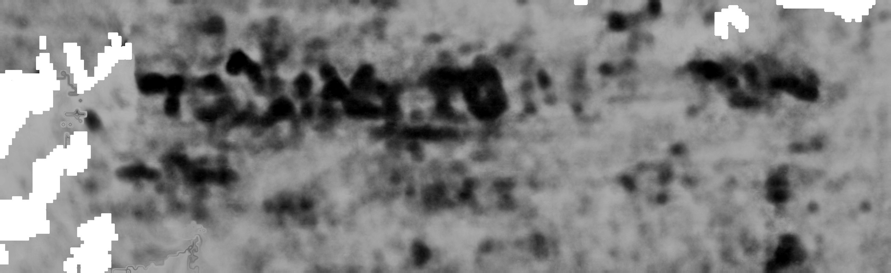

# followup: grow a local surface around a spot and test its ink against controls (CPU only)

A First Letters spot found on a spiral-fit sweep mesh usually sits on a mesh that is a few voxels off the sheet, cut
by a band edge, or too narrow to show a full line. The PHerc0306B winners re-grew a local surface from a seed on
the m7 surface predictions with VC3D GrowPatch before their claim. This kit packages that step so it can be run on any
spot, then checks what the ink models show on the new surface:

| script | what it does |
|---|---|
| `grow_region.sh` | VC3D `vc_grow_seg_from_seed` from a seed point on the public m7 surface prediction and its normal grids, then `vc_render_tifxyz` (24 layers, 1 voxel per pixel) and ink-sdk models (default reader-v3, rectina-m4) in both depth orders. Writes the tifxyz mesh, full-res and 2x-downsampled maps and a CT preview. |
| `confirm_region.sh` | False-positive controls on one window: 56-layer render, then `variants.py` (window centred at d−2..d+2, 15 voxels off the sheet on either side, depth-shuffled), models on every variant, then `confirm_stats.py` (Pearson r of each variant's map with d0, contrast, cross-model r, montage). Real surface ink persists at d±1, d±2 and vanishes off the sheet and under shuffling. |
| `mesh_resample.py` | Shows a map of mesh B in the grid frame of mesh A when both lie on the same sheet, e.g. a fresh GrowPatch against a sweep mesh or a published claim mesh. Prints the normal distance between the two surfaces. |
| `demo_306b.sh` | Known-answer demo on the awarded PHerc0306B line (below). |
| `kit_util.py` | Render to `.npy`, probability to PNG, and nearest grid node of a 3-D point. |

Everything runs on CPU. The ink models fall back to CPU, and GrowPatch and rendering are CPU-only. A GPU makes the
models about 10x faster. VC3D streams the CT, surface predictions and normal grids from the open-data bucket, so you
need no local copy of the scroll.

## Known-answer demo: PHerc0306B
`demo_306b.sh` starts from the seed the PHerc0306B winners published (3559, 3224, 9348; their `docs/METHOD.md`).
It grows 140 generations at step 20, renders 24 layers and runs **public reader-v3 only**. It then resamples the map
into the frame of the winners' claim mesh (`submission/mesh/...w074own_touchup_V5Rc` at commit `feabff6c`) and runs
the controls on a 2400-pixel window over the line.



The image above shows reader-v3 (forward order) on our grown surface, resampled into the winners' claim frame and
flipped top-to-bottom into their reading orientation (ink dark). The first line of their claim shows at the same
positions as in their TRACE v3B × A-hn image. Over that window the two surfaces lie a median 0.5 voxels apart along
the normal. Numbers and control statistics are in [`results/followup-306b/`](../results/followup-306b/).

So, on this region, a freshly grown GrowPatch surface plus public reader-v3 shows the awarded line. A spot that
stays blob-like after this follow-up is unlikely to be rescued by a better local surface alone.

## Run
Environment (as in [`../docs/environment.md`](../docs/environment.md)):
- `VC3D`: VC3D command-line tools, e.g. the release AppImage `f0e4410` (2026-11-11) extracted with
  `--appimage-extract`, then `VC3D=$PWD/squashfs-root/AppRun`.
- `INKSDK`: [LimeGS/ink-sdk](https://github.com/LimeGS/ink-sdk) @ `2df3ab50`. `KPY` is a python with villa's
  `koine_machines` (ink-detection uv venv, branch `merge-ink-pipelines` @ `47a9c37f6`), numpy, scipy, pillow, tifffile
  and zarr 2. `VILLA_SRC` is the villa directory that holds `ink-detection/` and `vesuvius/`. `MODELS_DIR` is
  filled by `ink-sdk fetch --profile ink_9um@reader-v3 --models-dir $MODELS_DIR`, and the same for rectina-m4.
- Optional `WRAP`, a container prefix applied to every python and ink-sdk call (VC3D runs outside it), and `WORK`
  (scratch; default `$SLURM_TMPDIR`).

```bash
# demo (about 3 h on 16 CPU cores: grow 27 min, reader-v3 45 min, controls 1-2 h)
VC3D=... INKSDK=... KPY=... VILLA_SRC=... MODELS_DIR=... bash followup/demo_306b.sh out/demo306b

# your own spot: seed = a 3-D point on the sheet (x y z voxels), e.g. a vertex of the sweep mesh under the spot
B=https://vesuvius-challenge-open-data.s3.us-east-1.amazonaws.com/<scroll>
S=$B/representations/predictions/surfaces/<volume>-surface-20260413222639-surface-m7-L0-th0.2
bash followup/grow_region.sh out/spot1 X Y Z 150 $S.zarr $S.normal-grids $B/volumes/<volume>-....zarr <pixel_um>
# controls on a window of the grown mesh (render pixels = grid node * STEP)
ORDER=rev bash followup/confirm_region.sh out/spot1_ctrl out/spot1/mesh_grow $B/volumes/<volume>-....zarr <pixel_um> X0 Y0 2400
```
On the open-data bucket, all 20 First Letters 2027-eligible volumes have the `...-surface-m7-L0-th0.2.zarr` and
`.normal-grids` predictions (listing 2026-11-14).

## Notes and limits
- VC3D `f0e4410` streams normal grids only from `<its remote-cache root>/s3/<bucket>/<key>` holding a
  `normal-grids-remote.json` marker. `grow_region.sh` writes that marker. With any other `normal_grid_path`, the
  grow fails.
- Seeds on one sheet can give opposite mesh normals and mirrored grid frames, so the same ink then shows in the
  `fwd` map of one patch and the `rev` map of another. Always look at both orders.
- A 150-generation patch is about 6000x6000 pixels at 24 layers, about 1 GB. Delete `render.npy` (default) unless you
  need it.
- GrowPatch can drift off the sheet over folds. The winners touched up the right end of their line. Check the CT preview
  (`ct_ds2.png`) before reading the maps.
- The controls detect model artefacts and ink-like features off the sheet. They do not judge legibility.

## Credits
Seed, claim mesh and method: [SirProdigle/pherc0306b-first-letters](https://github.com/SirProdigle/pherc0306b-first-letters)
(code MIT, data CC BY-NC 4.0; the demo downloads their mesh and does not redistribute it). VC3D GrowPatch:
[ScrollPrize/villa](https://github.com/ScrollPrize/villa). reader-v3 by DomRusso2 and rectina-m4, both via
[LimeGS/ink-sdk](https://github.com/LimeGS/ink-sdk). CT and surface predictions: Vesuvius Challenge open data.
