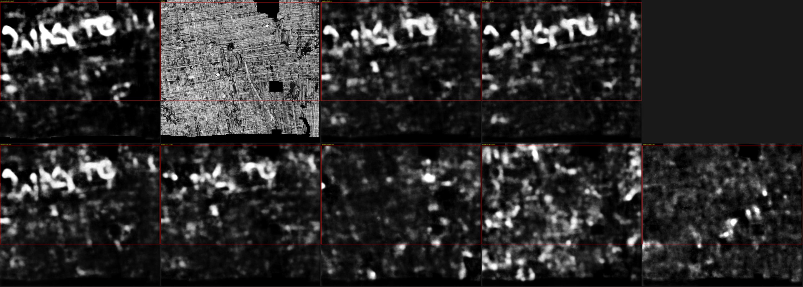

# herculex: second model and false-positive controls on a HerculeX piece (CPU only)

[HerculeX](https://github.com/adambetka2/HerculeX) (MIT, Adam Betka) unwraps a whole scan into pieces
(tifxyz surfaces) and inks each piece with reader-v3. Its whole-scan mosaics are a fast way to look for First Letters
candidates. A HerculeX ink image shows one model on one face, contrast-stretched. Before you trust forms in it, three
checks help: does an independent model show the same forms on the same surface? Do the forms persist a voxel or two
into the sheet, and vanish 15 voxels off it and under depth shuffling? Is the piece on the same sheet as a reference
surface, such as a claim mesh or a regrown patch? This kit runs those checks on a single piece.

| script | what it does |
|---|---|
| `piece_confirm.sh` | Renders the whole piece with VC3D `vc_render_tifxyz` at scale 1 (render pixel = grid cell × stride, stride 16 for HerculeX pieces) and runs [`../followup/confirm_region.sh`](../followup/) on it. That script builds the control variants (window centred at d−2..d+2, 15 voxels off the sheet on either side, depth-shuffled), runs reader-v3 and rectina-m4 in both depth orders on every variant, and writes persistence statistics and a montage. |
| `piece_sheet.py` | Review sheet: [HerculeX ink | CT | each model at d0] plus the first model on the controls. Aligns the HerculeX images to the render: it crops their 2-cell padding and tries 4 flips. It reports r of the HerculeX CT face against our CT (geometry check) and of the HerculeX ink against our reader-v3 in both orders (instrument check). |
| `place_check.py` | Normal distance from the nodes of a reference mesh, inside a row/col box, to a candidate mesh: overlap share, median/p10/p90, share ≤ 5 voxels, and the candidate cells and render box the overlap maps to. Also prints the nearest-node distance, to show why that measure misleads (below). |
| `demo_306b.sh` | Known-answer demo on the awarded PHerc0306B line (below). |
| `tests/test_place_check.py` | Synthetic known answers for `place_check.py`: same sheet, next sheet, tilted plane. |

**Why normal distance.** tifxyz nodes are often 16–20 voxels apart. Two meshes of the same sheet therefore read about
half a node spacing apart by nearest-node distance. We measured a median of 8.5–8.9 voxels on mesh pairs whose normal
distance was 0.3–0.7. Sheet pitch is about 10–15 voxels in many scrolls, so nearest-node distance cannot tell "same
sheet" from "next sheet".

## Known-answer demo: PHerc0306B
`demo_306b.sh` runs on one HerculeX piece shipped in [`../results/herculex-306b/`](../results/herculex-306b/):
- **The piece:** PHerc0306B scan 20250521133212, band rows 30–42, piece 7000024, with its CT face and 'taught' ink images.
- **How it was made:** HerculeX PR#1 `0d73c4c` with our band/shard patches, on CPU.
- **Why this piece:** it holds part of the awarded first line.

The demo runs `piece_confirm.sh` on the whole piece, then `place_check.py` against the winners' claim mesh (fetched at
commit `feabff6c`, CC BY-NC 4.0), then `piece_sheet.py`. Results from a clean checkout (CPU, 16 cores, 31 min):



Top row of the sheet, as rendered (not the reading orientation): HerculeX's ink, the CT, reader-v3 and rectina-m4.
The awarded line is at the top in all three ink maps. Bottom row: reader-v3 at d−2 and d+2, where the line persists,
then 15 voxels below and above the sheet and depth-shuffled, where it is gone. The red box is where the winners' claim
box falls on the piece.

- **Same surface.** 52% of the winners' claim-box nodes (rows 82–137, cols 121–341 of their `V5Rc` mesh) lie within
  25 voxels of the piece. Over that overlap the normal distance is median 2.75 voxels (p10 0.46, p90 7.13), and 77% of
  nodes are within 5 voxels. Nearest-node distance reads 7.54 for the same nodes.
- **Our render reproduces HerculeX's ink.** HerculeX's CT face image matches our CT render without a flip (r 0.651;
  the other flips give ≤ 0.05). HerculeX's ink matches our reader-v3 at r 0.842 in **reverse** depth order and 0.04 in
  forward order. Run both orders on HerculeX pieces; `piece_sheet.py` picks the matching one.
- **Second model and controls.** rectina-m4 agrees with reader-v3 at r 0.899 (reverse order, whole piece). Pearson r
  of each variant's map with the d0 map (reverse order, whole piece 2304×2064 px, `controls_stats.json`):

| variant | reader-v3 r | rectina-m4 r |
|---|---|---|
| window centre d−2 / d−1 | 0.954 / 0.984 | 0.952 / 0.982 |
| window centre d+1 / d+2 | 0.976 / 0.910 | 0.974 / 0.914 |
| 15 voxels off the sheet, −15 / +15 | 0.186 / 0.026 | 0.218 / 0.025 |
| depth-shuffled | 0.037 | 0.008 |

The montage in `confirm/` uses forward order (`ORDER`); `stats.json` holds both orders.

A caution from our use on other pieces: the 'taught' image is contrast-stretched and saturated. It makes forms look
crisper than the raw model maps do. Judge letter forms from the raw maps on the sheet.

## Your own piece
```bash
# a HerculeX piece: <HERCULEX_OUTPUTS>/unwrapping/level/<scroll>/<scan>/pieces/<unit>/piece-<n>/
# its images:       <HERCULEX_OUTPUTS>/unwrapping/level/<scroll>/<scan>/faces/level-0/<unit>/piece-<n>{,-taught}.png
VC3D=... INKSDK=... KPY=... VILLA_SRC=... MODELS_DIR=... \
  bash herculex/piece_confirm.sh out/p <piece dir> <CT zarr URL> <pixel um>
python3 herculex/piece_sheet.py out/p --out out/p/sheet.png --ct-face <faces>/piece-<n>.png --ink-face <faces>/piece-<n>-taught.png
python3 herculex/place_check.py <reference tifxyz> <piece dir> --rows r0:r1 --cols c0:c1
```
Use `VSEL="d0"` for a quick two-model check, then run all variants on the pieces that pass. On 16 CPU cores a piece of
about 2000×2000 px takes 3–6 min per model per variant, after a render of under a minute. Environment: as
[`../followup/`](../followup/) (VC3D, ink-sdk, koine Python with numpy, scipy, PIL and tifffile).

## Reproduce
```bash
python3 herculex/tests/test_place_check.py                                              # 3 synthetic tests
VC3D=... INKSDK=... KPY=... VILLA_SRC=... MODELS_DIR=... bash herculex/demo_306b.sh out/hx306b   # CPU, ~30 min
```
The demo outputs in `results/herculex-306b/` (`summary.txt`, `controls_stats.json`, `place_check.json`,
`sheet.json`, `sheet.jpg`) are from a clean checkout of these scripts.

Data: the piece and its images derive from the PHerc0306B CT (Vesuvius Challenge open data, CC BY-NC 4.0) and are
shared under the same license. HerculeX: MIT.
