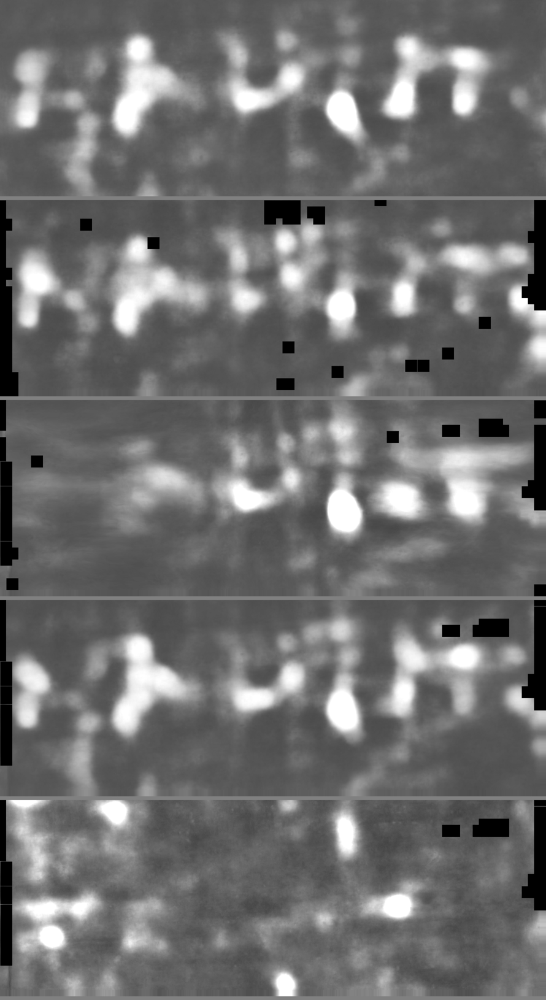

# isoregrid/: isometric re-grid of a tifxyz surface

villa's `fit_spiral` writes each winding as a tifxyz grid that is regular in (angle, z), not in 3D. Rows follow z and
stay about one step apart. Columns follow the angle, so their 3D spacing changes with the local radius and with how
the sheet bends: on the PHerc0211 fit below, column edges run from about 16 to 44 voxels (10th to 90th percentile)
for a nominal 20, and over 50 in places. A render at one pixel per grid unit then stretches the text in some places and squashes it in others, and an ink model sees
letters of the wrong shape.

`iso_regrid.py` keeps the surface and replaces the grid. It flattens the valid nodes to 2D by a mass-spring fit to
their 3D edge lengths and samples x/y/z on a regular 2D grid, by barycentric interpolation inside the input grid's own
triangles. Every output edge is then about `--step` voxels long in 3D. The tool reports the input and output
distortion |edge3D/step − 1| (median and p95 over row and column edges). A First Letters submission's mesh must
include "a low-distortion isometric 2D parametrization (flattening)" (scrollprize.org/prizes, read 2026-11-28). The page
sets no metric; this edge-length distortion is one simple way to measure and report it. The tool gives spiral-fit windings such a flattening and reports
how close it comes.

## Files
| file | what it does |
|---|---|
| `iso_regrid.py` | `iso_regrid.py <in tifxyz> <out tifxyz> [--step 20] [--iters 200]`: mass-spring flatten (scipy `least_squares`, row, column and diagonal edges) → rotate so rows follow z as in the input → barycentric re-sampling at `step` voxels → x/y/z.tif, meta.json (scale 1/step) and `iso_info.json` (input and output distortion, flipped triangles, valid fraction). Invalid nodes are −1. |
| `squash.py` | `squash.py <in> <out> [--amp 0.6] [--period 6]`: synthetic angle-z-like squash. The columns are re-sampled with a smooth, non-uniform spacing, so column edges run from 0.4x to 1.6x of the step. Rows are unchanged, and the surface stays the same while its grid is distorted. |
| `normal_dn.py` | `normal_dn.py <A> <B> [--json f]`: normal distance of mesh A's nodes to mesh B's surface (nearest B node, then distance along B's grid normal there). It tests whether two grids describe the same surface. The nearest-node distance is also reported, but it mostly measures grid spacing. |
| `arm_check.py` | One demo arm: distortion in/out, normal distance of the output to a reference, fixed bars, one JSON. |
| `demo_0211.sh` | Known-answer demo on public PHerc0211 data (below). CPU, about 1–2 min. |
| `data/w034_fit/` | A raw spiral-fit winding over the awarded PHerc0211 region (input of the FIT arm; see `meta.json`). |
| `tests/test_iso_regrid.py` | Synthetic tests on a curled developable sheet. Irregular columns → isometric output on the true surface; an isometric grid stays isometric (no-op); `squash.py` keeps the surface; `normal_dn.py` recovers a known 3-voxel offset. |

## Known answer: PHerc0211, the awarded First Letters region
`demo_0211.sh` downloads the awardees' hand-refined mesh of the region from the open-data bucket
(`PHerc0211/segments/20261028201525-crop1711-lines123-v9/mesh/20261028201525-on-20250821151803-9.362um.tifxyz`,
called v9 here; 86 × 300 nodes at 20 voxels; the demo writes its sha256 to `v9.sha256`, and the run below used x.tif
`f0e5b5dd…`, y.tif `25870824…`, z.tif `f8dc5b4c…`). It runs three arms, each with bars fixed before the first clean-checkout
run:

| arm | input | input distortion (median / p95) | output distortion (median / p95) | normal distance, output → reference (median / p90, voxels) | bars |
|---|---|---|---|---|---|
| NOOP | v9 (already isometric) | 0.005 / 0.026 | **0.006 / 0.038** | 0.18 / 0.62 (to v9) | out < 0.02 / < 0.06; dn ≤ 0.5 |
| SQUASH | v9 squashed by `squash.py` | 0.027 / **0.594** | **0.006 / 0.033** | 0.24 / 0.79 (to the unsquashed v9) | in p95 ≥ 0.5; out < 0.02 / < 0.06; dn ≤ 0.5 |
| FIT | `data/w034_fit` (raw spiral fit) | 0.109 / **1.256** | **0.006 / 0.051** | 0.42 / 1.59 (to w034_fit) | in p95 ≥ 0.5; out < 0.02 / < 0.08; dn ≤ 0.5 |

All three arms pass. Fold-overs dropped: 1162 of 43914 triangles (NOOP), 1055 of 43266 (SQUASH) and 221 of 18436
(FIT). The output keeps the input's left-right and top-bottom sense. Raw outputs are in
[`results/isoregrid-0211/`](../results/isoregrid-0211/).

`data/w034_fit` is winding 34 of a villa `fit_spiral` fit (commit d63d3e968, surface tracks on, z 8000–9100) of
PHerc0211 volume 20250821151803. Each node was then moved along its normal, by at most 15 voxels, onto the public m7
surface prediction. It lies a median 1.9 voxels from v9 over the award crop. It is not re-gridded: its column edges
follow the fit's (angle, z) grid. The FIT arm's output is node for node the same (same valid mask, largest coordinate
difference 0.0 voxels) as the re-gridded winding used in the ink run below.

### Ink on the re-gridded fit (project-run evidence, not reproduced by this demo)
These numbers come from this project's own pipeline (VC3D render, reader-v3 and rectina-m4 in the reverse depth order,
maps resampled into the v9 frame over the award crop, v9 rows 32–64 × columns 94–183). Each is the Pearson r against the
same models' map on v9 itself. The bars were fixed before the run. The project used a copy of v9 with 87 × 301 nodes; the
public mesh that the demo downloads has 86 × 300. The render and resampling scripts are not part of this kit.

| surface | r vs the v9 map |
|---|---|
| raw fit w034 (`data/w034_fit`) | 0.741 (below the 0.86 bar; the left half of the row's forms are missing) |
| w034 after `iso_regrid.py` | **0.912** (same surface 15 voxels off the sheet: 0.121) |
| a HerculeX piece of the same row, for comparison | 0.813 |
| v9 re-gridded by `iso_regrid.py` (no-op control) | 0.974 |
| v9 with a 1.25x synthetic column squash | 0.884; after `iso_regrid.py` 0.981 |



Top to bottom, each row the mean of the z-scored reader-v3 and rectina-m4 maps (reverse order, d0), in the v9 frame of the
award crop, at half resolution: the map on v9 (V-V); on the HerculeX
piece (H-V); on the raw fit; on the re-gridded fit; on the re-gridded fit 15 voxels off the sheet (null). The
re-gridded fit shows the award forms, including the left half that the raw fit loses. Project-run evidence, not
produced by `demo_0211.sh`.

A higher map correlation is not the same as legible letters. In a later blind count, four independent AI readers (fresh Claude subagents
with a fixed brief) each read crops of this row. The re-gridded fit's maps gave 0 legible letters on average, and so did the HerculeX piece's maps with the same
models. The awardees' published image of the row gave 3.5. That count could not tell the surfaces apart, so it does not
show whether re-gridding makes letters legible. Re-gridding fixes the grid's shape, but the fit still lies about 1.8
voxels off v9's hand-refined surface.

## Reproduce
```bash
python3 isoregrid/tests/test_iso_regrid.py                     # CPU, seconds
PY=python3 bash isoregrid/demo_0211.sh out/iso0211             # CPU, about 2-5 min; exits non-zero if a bar fails
python3 isoregrid/iso_regrid.py <your winding.tifxyz> <out.tifxyz> --step 20
```

## Who this helps
- Anyone rendering or reading ink on spiral-fit windings, or on any tifxyz grid that is not isometric: re-grid first,
  then render. Letter shapes are then not stretched by the grid, and the distortion numbers say how far the grid is from
  isometric. On the one row tested, this raised map agreement, not a measured letter count (see above).
- Anyone assembling a First Letters package: the package needs a low-distortion isometric 2D flattening of
  the mesh, and the distortion report gives a number for it, computed on the mesh you will submit.

## Requirements
- Python 3 with numpy, scipy and tifffile (tested: Python 3.11.5, numpy 1.25.2, scipy 1.11.2, tifffile 2025.5.10).
  `curl` for the demo download (about 0.3 MB). No GPU and no VC3D.
- Run time of `iso_regrid.py`: about 15–20 s for an 86 × 300-node mesh on one CPU core (the triangle rasterisation is a Python loop).

## Limits
- Tested only on the meshes above: the v9 mesh, its synthetic squash and one spiral-fit winding of PHerc0211, plus
  synthetic sheets. Larger meshes need more time and memory in the least-squares step. No large surface has been tried.
- The flatten is one global least-squares fit with no fold handling. Folds, self-overlaps and sheets that touch
  themselves are not unrolled. Triangles that flip in 2D are dropped and counted (`flipped_triangles`), which leaves
  small holes; 1–3% of triangles flipped on the meshes above. A large count means the input has fold-overs or
  is not developable at that scale.
- Re-gridding is linear inside each input triangle, so it cannot add detail. The output is no closer to the papyrus than
  the input (FIT: about 1.9 voxels from v9 before re-gridding and 1.8 after, in the project's measurements).
- The output distortion is not zero: a curved surface that is not developable cannot be flattened without some stretch.
  The output p95 was 0.033–0.051 on the meshes above.
- `normal_dn.py` uses the tangent plane at the nearest node. For points between nodes on a curved sheet it is off by a
  few tenths of a voxel: 0.5 at half a 20-voxel node on a radius of 140–300 voxels in the tests. This floor is part
  of the dn numbers above. FIT's 0.42 is mostly this floor, since every output node lies on the input's triangles.
- Alternatives: villa's lasagna flattening and VC3D's own flattening and re-meshing tools produce isometric
  parameterisations too. We have not compared against them.
