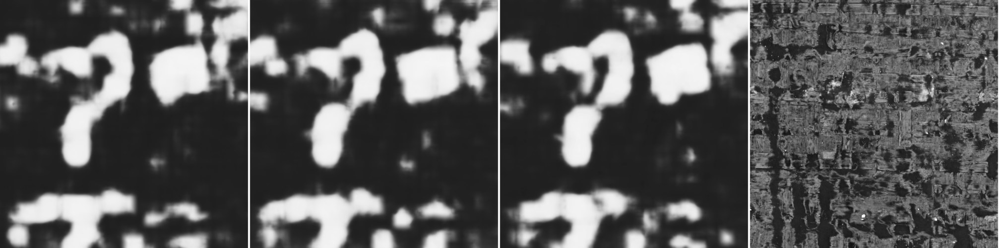

# rescan/: the canonical 2.4 µm ink model on 2.4 µm rescans, for any mesh

Several scrolls now have ~2.4 µm rescans next to their ~9.36 µm scans, and the Vesuvius Challenge team publishes
official transforms between the volumes of a scroll (`<scroll>/transforms/<moving>-to-<fixed>-r1/fit/transform.json` on
the open-data bucket). This kit renders a window of any tifxyz mesh on a 2.4 µm rescan and runs the team's canonical
2.4 µm ink model (`canonical_2um@r152-3ddec-v2-l5-epoch13`, via [ink-sdk](https://github.com/LimeGS/ink-sdk)) on it.

The mesh can belong to another volume of the same scroll. For example, a 9.36 µm segment from your own unwrap can be
mapped into the rescan by the inverse official transform. VC3D maps every mesh vertex into the rescan
(`vc_render_tifxyz --affine <transform.json>:inv`), then samples along the grid normals at the rescan's voxel size.
A 9.36 µm grid becomes about 3.9 rescan pixels per voxel.

The model reads one depth order only, so both orders are run as separate inputs. On the known answer below, only one
order reproduces the team's map.

## Files
| file | what it does |
|---|---|
| `render_infer.sh` | `render_infer.sh <out> <tifxyz> <ct_url> <pixel_um> <transform.json[:inv] or -> <x0> <y0> <w> <h>`: VC3D render (96 layers) → central 62 layers → canonical_2um in both depth orders → `maps/d0_{fwd,rev}.{png,npy}`, `ct.png` |
| `nodecorr.py` | Node correspondence between two meshes of one sheet in two volumes (maps A by the transform, nearest B node, 2D affine fit). It is used to compare maps made on different meshes. |
| `kat_compare.py` | `window` gives the render window of the mapped mesh that covers a window of the reference map. `compare` gives Pearson r (Gaussian σ 4 px) of our maps against the team map and of the mapped-mesh map against the in-volume map, and writes a side-by-side sheet. |
| `demo_0139.sh` | Known-answer demo on public PHerc0139 data (below). |
| `tests/test_rescan.py` | Synthetic tests: the node fit recovers a known correspondence; the resampling into the reference frame is exact; a window of a tiled, compressed team-map TIFF is read exactly. |

## Known answer: PHerc0139, segment 20250108000000-w025
The team publishes a canonical 2.4 µm ink map for this segment, made on the segment's 2.399 µm mesh
(`segments/20250108000000-w025_2025010863/ink-detection/...-new_canon_autoresearch_recipe-tile256-stride128.tif`).
`demo_0139.sh` downloads the segment's two meshes (2.399 µm on rescan 20260102150214, 9.362 µm on volume
20250728140407), the official transform `20260102150214-to-20250728140407-r1` and the team map. It then compares one
3000 × 3000 px window of the team map (rows 4000–7000, cols 11500–14500), which holds clear letter forms:

| check | what is compared | Pearson r (σ 4 px) | bar |
|---|---|---|---|
| B | 2.399 µm mesh rendered on the rescan + canonical_2um, against the team map | **0.940** reverse order (forward −0.151) | ≥ 0.8 |
| C | 9.362 µm mesh mapped into the rescan by the inverse official transform, resampled into the window, against B | **0.931** reverse order (forward −0.135); against the team map 0.929 | ≥ 0.6 |

The CT faces of B and C agree at r 0.979. The node fit between the two meshes has scale 3.890 (9.362 / 2.399 = 3.903)
and a residual of median 0.43 nodes of the 2.4 µm mesh. Both bars were fixed before the run.



Left to right: the team map, B, C resampled into the team window, and the CT face of B. The large forms of the team map
appear at the same places in B and C. Raw outputs are in [`results/rescan-0139/`](../results/rescan-0139/): `kat.json`,
`corr.json` (node fit), logs and the run's manifests, with local paths replaced by `<out>`, `<tmp>` and `<checkout>`.
They come from a clean checkout of commit `bae8927` on one H100 MIG 3g.40gb slice. The demo took 215 s, including
downloads and CT streaming. Reproduce:

```bash
python3 rescan/tests/test_rescan.py                                                  # CPU, seconds
VC3D=... INKSDK=... KPY=... VILLA_SRC=... MODELS_DIR=... bash rescan/demo_0139.sh out/rescan0139    # GPU, a few minutes
```

## Who this helps
- Anyone with a 9.36 µm segment of a scroll that also has a 2.4 µm rescan: you can see what the team's canonical 2.4 µm
  model shows on your own surface, without retracing the sheet in the rescan.
- Anyone distilling ink labels from higher-resolution scans into 9 µm models: this produces 2.4 µm-model maps on the
  exact surface you will train on, in that surface's own frame.

## Requirements
- VC3D with `vc_render_tifxyz --affine` (tested: AppImage f0e4410, 2026-11-11); `VC3D` = the command that runs its tools,
  e.g. `<extracted AppImage>/squashfs-root/AppRun`. It streams CT chunks from the open-data bucket.
- [ink-sdk](https://github.com/LimeGS/ink-sdk) at `2df3ab50`. Fetch the weights once with
  `ink-sdk fetch --profile canonical_2um@r152-3ddec-v2-l5-epoch13 --models-dir $MODELS_DIR`; ink-sdk checks their sha256.
  `VILLA_SRC` = a villa checkout (as for the other kits), `KPY` = a Python with numpy, scipy, opencv, tifffile and Pillow (no zarr needed).
- A GPU for the model: canonical_2um took 30–55 s per order on a 9–12 Mpx window on one H100 MIG slice (3g.40gb or 2g.20gb).

## Limits
- Only checked on PHerc0139 with the official r1 transform. A transform with larger local residuals puts the mesh off the
  sheet in the rescan. Check the CT face (`ct.png`) against your 9 µm render before reading ink.
- The canonical model is trained on the team's 2.4 µm scans. We have not shown that it reads ink equally well on every
  rescan. Before you trust a negative on a new scan, run it at a place with known ink on that scan.
